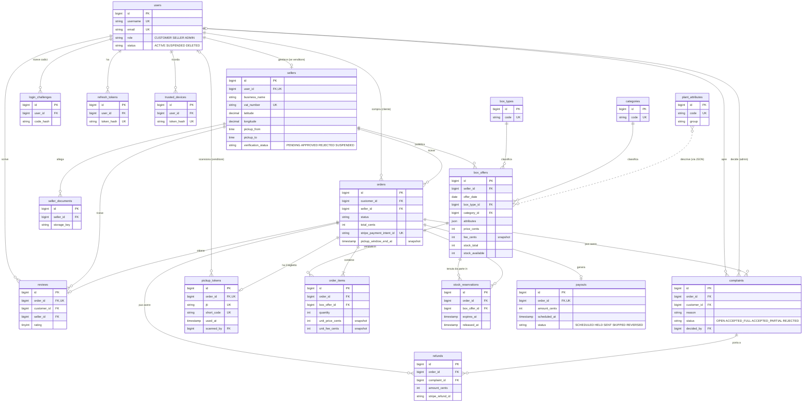
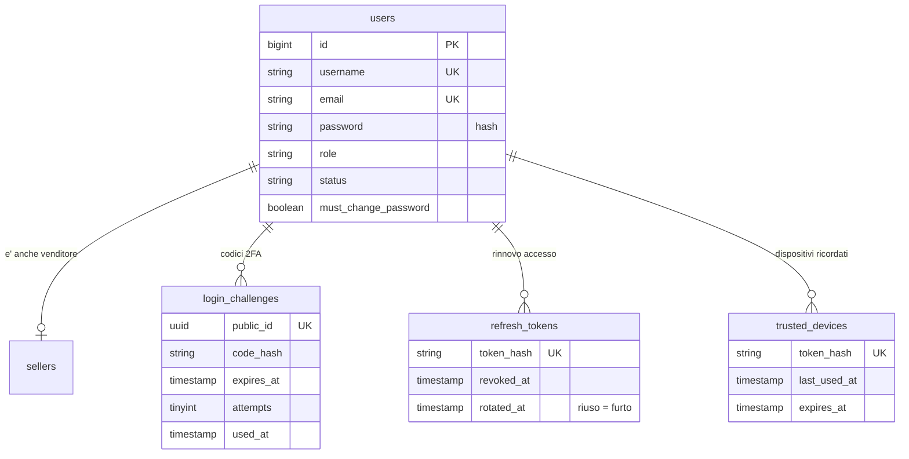
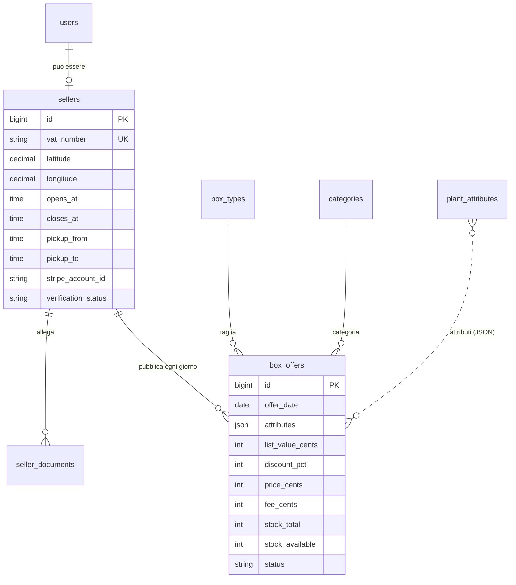
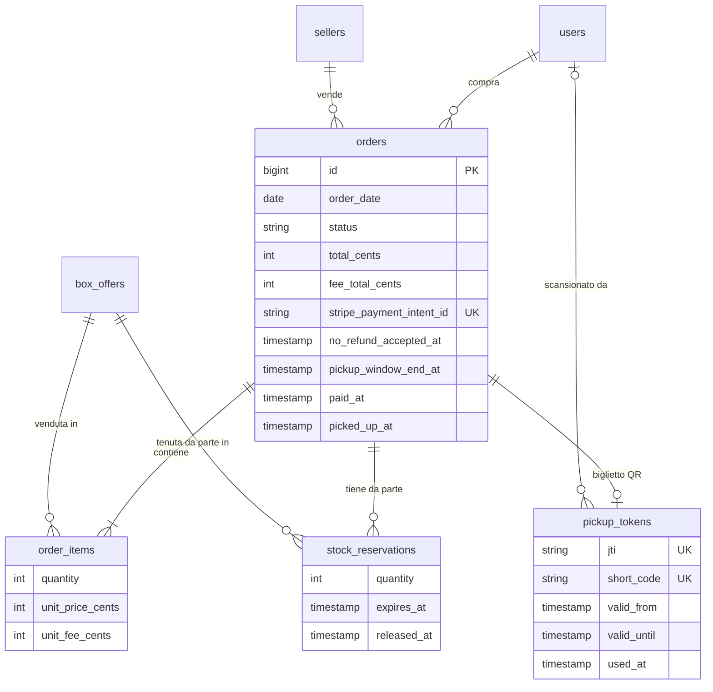
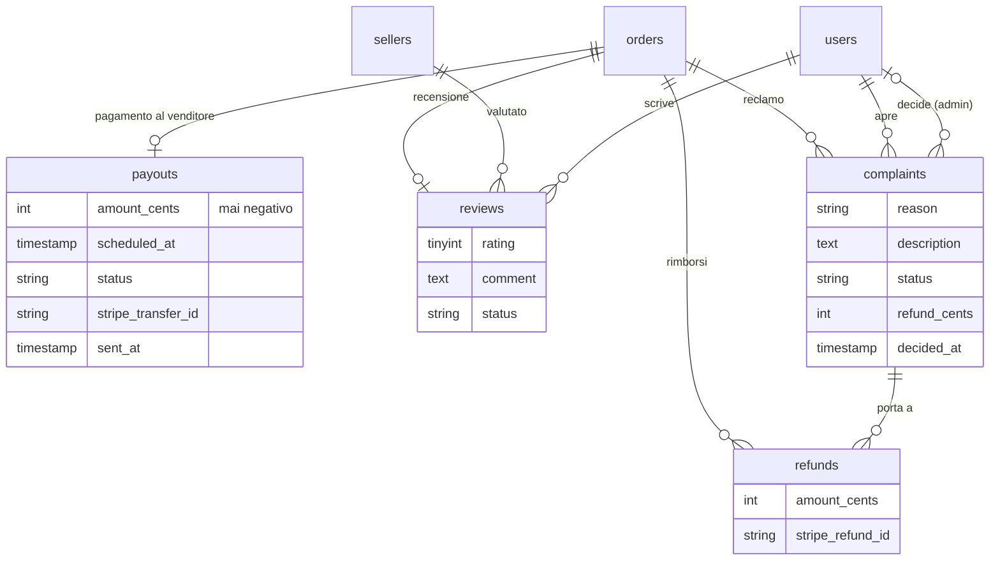
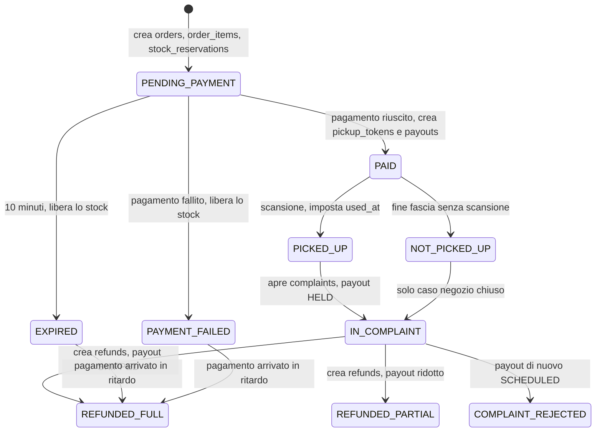

# Schema ER (entità–relazioni)

Lo schema **concettuale** del database: le entità, come sono collegate e con quali cardinalità. I tipi di dato, le chiavi e gli indici sono nello schema logico: [03-schema-logico.md](03-schema-logico.md). Il perché di ogni scelta è in [01-scelte-e-tabelle.md](01-scelte-e-tabelle.md).

> **Come vedere i diagrammi.** Sono scritti in **Mermaid**: GitHub li disegna da solo aprendo questo file. In VS Code serve l'estensione "Markdown Preview Mermaid Support"; in alternativa si incolla il blocco su https://mermaid.live. Il codice sotto ogni diagramma è il sorgente: si modifica come testo.

## Come leggere la notazione

| Simbolo | Significato |
|---|---|
| `\|\|--o\|` | uno a (zero o uno) |
| `\|\|--o{` | uno a (zero o molti) |
| `\|\|--\|{` | uno a (uno o molti) |
| `PK` / `FK` / `UK` | chiave primaria / chiave esterna / valore unico |

Leggere sempre da sinistra a destra: `users ||--o| sellers : "ha"` = "un utente ha **al più un** venditore; un venditore appartiene a **esattamente un** utente".

---

## 1. Schema completo

Mostra tutte le entità di business e le loro relazioni. Per non appesantire il disegno, per ogni entità sono indicati solo gli attributi più significativi; l'elenco completo è nello schema logico.

### Le relazioni, una per una

| Relazione | Cardinalità | Come è garantita | Significato |
|---|---|---|---|
| `users` – `sellers` | 1 : 0..1 | `sellers.user_id` unico | un account venditore ha una sola attività; i clienti e gli admin non ne hanno |
| `users` – `orders` (cliente) | 1 : N | FK `orders.customer_id` | un cliente fa molti ordini |
| `sellers` – `orders` | 1 : N | FK `orders.seller_id` | un negozio riceve molti ordini; **ogni ordine è di un solo negozio** |
| `sellers` – `box_offers` | 1 : N | FK `box_offers.seller_id` | un negozio pubblica molte offerte (una o più per giorno) |
| `box_types`, `categories` – `box_offers` | 1 : N | FK | ogni offerta ha una taglia e una categoria |
| `plant_attributes` – `box_offers` | **N : M** | **nessuna FK**: array JSON `box_offers.attributes` | molte caratteristiche per box, molte box per caratteristica (vedi nota) |
| `orders` – `box_offers` | **N : M** | tabella `order_items` | un ordine contiene più box; una box finisce in più ordini |
| `orders` – `order_items` | 1 : 1..N | FK `order_items.order_id` (cascade) | un ordine ha **almeno una** riga (regola dell'API) |
| `orders` – `stock_reservations` | 1 : N | FK | una prenotazione per ogni box dell'ordine |
| `orders` – `pickup_tokens` | 1 : 0..1 | `order_id` unico | il biglietto esiste solo per gli ordini pagati |
| `orders` – `payouts` | 1 : 0..1 | `order_id` unico | un solo pagamento al venditore per ordine, creato al pagamento |
| `orders` – `reviews` | 1 : 0..1 | `order_id` unico | una sola recensione per ordine |
| `orders` – `complaints` | 1 : 0..N nel DB, **0..1 per regola** | FK; unicità imposta dal codice con riga bloccata | vedi nota |
| `orders` – `refunds`, `complaints` – `refunds` | 1 : N | FK (`complaint_id` può essere nullo) | un reclamo accolto genera un rimborso |
| `users` – `pickup_tokens` (scansione) | 1 : N, opzionale | FK `scanned_by` nullable | chi ha letto il QR |
| `users` – `complaints` (decisione) | 1 : N, opzionale | FK `decided_by` nullable | quale admin ha deciso |
| `users` – `login_challenges`, `refresh_tokens`, `trusted_devices` | 1 : N | FK (cascade) | i codici e i token di accesso dell'utente |
| `sellers` – `seller_documents` | 1 : N | FK (cascade) | i documenti caricati |

**Nota sulla N : M con `plant_attributes`.** È l'unica relazione concettuale che il database non rappresenta con una tabella ponte: l'elenco dei codici sta in una colonna JSON. La scelta e il suo costo sono spiegati in [01-scelte-e-tabelle.md](01-scelte-e-tabelle.md) (sezione 2). Nel disegno è tratteggiata (`..`) per ricordarlo.

**Nota sui reclami.** Il modello concettuale dice "un ordine ha al più un reclamo"; lo schema fisico ammette di più e la regola è nel codice. È l'unica cardinalità dove schema e regola non coincidono.

---

## 2. Lo stesso schema, diviso per area

Per leggerlo (o presentarlo) a pezzi.

### 2.1 Identità e accesso

Fuori da queste relazioni (e quindi senza FK) ci sono due tabelle di accesso: `password_reset_tokens` (chiave = email) e `personal_access_tokens` (relazione polimorfica di Sanctum).

### 2.2 Dal venditore all'offerta

### 2.3 Acquisto, prenotazione e ritiro

### 2.4 Denaro, recensioni e reclami

Tabelle **senza relazioni** con le altre, perché sono registri a sé:

| Tabella | Cos'è |
|---|---|
| `config_params` | parametri di business (chiave testuale) |
| `stripe_events` | id degli eventi Stripe già elaborati (idempotenza) |
| `cache`, `cache_locks`, `jobs`, `job_batches`, `failed_jobs`, `migrations` | tabelle tecniche di Laravel |

---

## 3. Come cambia lo stato di un ordine (e delle tabelle collegate)

Non è un diagramma ER, ma serve a capire perché alcune tabelle esistono. Ogni freccia è una modifica a una o più righe.

Gli stati terminali sono `PICKED_UP`, `NOT_PICKED_UP` (se nessuno protesta), `REFUNDED_FULL`, `REFUNDED_PARTIAL`, `COMPLAINT_REJECTED`, `EXPIRED` e `PAYMENT_FAILED`. Il payout, a sua volta, passa per `SCHEDULED → SENT`, oppure `HELD`, `SKIPPED`, `REVERSED` (storno dopo un reclamo accolto a trasferimento già inviato).
