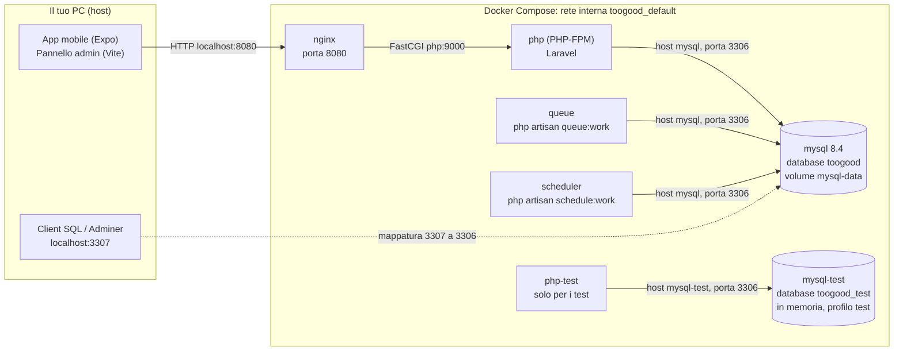

# Come funziona il database e come è collegato a Docker

Sì: il database è **MySQL 8.4 e gira in un container Docker**. Non va installato sul PC: basta Docker Desktop. Questo documento spiega come nasce, come ci arriva l'applicazione, come si crea lo schema, come si protegge dagli errori e come lo si guarda da fuori. Per le tabelle: [01](01-scelte-e-tabelle.md), [02](02-schema-er.md), [03](03-schema-logico.md).

---

## 1. Il quadro d'insieme



Punti da capire:
- L'app **non parla mai direttamente con il database**: parla con l'API (nginx → PHP), e solo PHP apre connessioni a MySQL.
- Dentro la rete Docker i container si chiamano **per nome del servizio** (`mysql`, `php`, `nginx`). Fuori da Docker, il database si raggiunge su `localhost:3307`.
- Tre container usano **la stessa immagine PHP e lo stesso database**: `php` (risponde alle richieste), `queue` (esegue i lavori in coda) e `scheduler` (lancia i comandi pianificati, come `payouts:run` ogni 10 minuti o `orders:close-pickup` ogni minuto).

---

## 2. Il servizio MySQL nel `docker-compose.yml`

```yaml
mysql:
  image: mysql:8.4
  command: >
    --character-set-server=utf8mb4
    --collation-server=utf8mb4_unicode_ci
    --default-time-zone=+00:00
  environment:
    MYSQL_ROOT_PASSWORD: root
    MYSQL_DATABASE: toogood
    MYSQL_USER: toogood
    MYSQL_PASSWORD: secret
  ports:
    - "3307:3306"
  volumes:
    - mysql-data:/var/lib/mysql
  healthcheck:
    test: ["CMD-SHELL", "mysqladmin ping -h 127.0.0.1 -uroot -proot --silent"]
    interval: 5s
    timeout: 5s
    retries: 30
```

| Riga | Cosa fa e perché |
|---|---|
| `image: mysql:8.4` | versione fissa per tutti. Serve la 8.x per `ST_Distance_Sphere` (distanza in SQL) e per il vincolo `CHECK` sullo stock |
| `--character-set-server=utf8mb4` e `--collation-server=utf8mb4_unicode_ci` | testo Unicode completo (accenti, emoji) e confronti senza distinguere maiuscole/minuscole e accenti |
| `--default-time-zone=+00:00` | **le date nel database sono sempre in UTC**; il fuso `Europe/Rome` si applica solo in PHP quando serve (vedi [01](01-scelte-e-tabelle.md), sezione 2) |
| `MYSQL_DATABASE`, `MYSQL_USER`, `MYSQL_PASSWORD` | al **primo avvio, con il volume vuoto**, MySQL crea da solo il database `toogood` e l'utente `toogood` con quella password. Le credenziali sono **solo di sviluppo** |
| `MYSQL_ROOT_PASSWORD: root` | serve al controllo di salute e agli amministratori; solo sviluppo |
| `ports: "3307:3306"` | formato `porta-sul-PC:porta-nel-container`. MySQL ascolta sulla 3306 *dentro* il container; sul PC la espone alla **3307** per non scontrarsi con un eventuale MySQL già installato sulla 3306 |
| `volumes: mysql-data:/var/lib/mysql` | **volume con nome**: i file del database vivono fuori dal container, in un volume Docker (`toogood_mysql-data`). Così spegnere o ricreare i container **non cancella i dati** |
| `healthcheck` | Docker prova `mysqladmin ping` ogni 5 secondi (fino a 30 volte) e marca il container "healthy" solo quando MySQL risponde davvero |

### Perché il controllo di salute è importante
Il container `php` dichiara:

```yaml
depends_on:
  mysql:
    condition: service_healthy
```

Cioè **non parte finché MySQL non è pronto a ricevere connessioni**. Senza, `docker compose up` avvierebbe PHP mentre MySQL sta ancora inizializzando e le prime richieste (o la coda e lo scheduler) fallirebbero con "connection refused".

### Cosa succede ai dati
| Comando | Effetto sul database |
|---|---|
| `docker compose down` | spegne i container, **i dati restano** (il volume resta) |
| `docker compose up -d` | li riaccende: ritrovi tutto com'era |
| `docker compose down -v` | spegne **e cancella il volume**: database vuoto al prossimo avvio |
| `migrate:fresh --seed` | cancella tutte le tabelle e le ricrea con i dati fissi (senza spegnere nulla) |

---

## 3. Come l'applicazione si collega al database

La catena è: **`.env` → `config/database.php` → driver `pdo_mysql` → rete Docker → container `mysql`**.

### 3.1 Il file `.env`
Il file `apps/api/.env` (copia di `.env.example`) contiene:

```
DB_CONNECTION=mysql
DB_HOST=mysql
DB_PORT=3306
DB_DATABASE=toogood
DB_USERNAME=toogood
DB_PASSWORD=secret
```

Due dettagli che confondono spesso:
- **`DB_HOST=mysql`**, non `localhost`: `mysql` è il **nome del servizio** nel compose. Docker ha un DNS interno che lo traduce nell'indirizzo del container. `localhost`, dentro il container PHP, indicherebbe il container PHP stesso e non troverebbe nessun database.
- **`DB_PORT=3306`**, non `3307`: dentro la rete Docker si usa la porta *vera* del container. La 3307 esiste solo sul PC (mappatura `3307:3306`) per i programmi esterni.

### 3.2 Come il file arriva ai container
Nel compose c'è un blocco condiviso (`x-php: &php`) usato da `php`, `queue`, `scheduler` e `php-test`:

```yaml
env_file:
  - ./apps/api/.env
volumes:
  - ./apps/api:/var/www/html
```

- `env_file` rende le variabili di `.env` disponibili ai processi PHP, quindi tutti e tre i container si collegano **allo stesso database** con le stesse credenziali.
- La cartella `apps/api` è montata dentro il container (`/var/www/html`): modificare il codice sul PC ha effetto subito, senza ricostruire nulla.

### 3.3 Dal file alla connessione
`apps/api/config/database.php` legge le variabili:

```php
'mysql' => [
    'driver'    => 'mysql',
    'host'      => env('DB_HOST', '127.0.0.1'),
    'port'      => env('DB_PORT', '3306'),
    'database'  => env('DB_DATABASE', 'laravel'),
    'username'  => env('DB_USERNAME', 'root'),
    'password'  => env('DB_PASSWORD', ''),
    'charset'   => env('DB_CHARSET', 'utf8mb4'),
    'collation' => env('DB_COLLATION', 'utf8mb4_unicode_ci'),
    ...
],
```

Il driver è `pdo_mysql`, l'estensione PHP che il `Dockerfile` installa:

```dockerfile
FROM php:8.4-fpm
RUN apt-get update && apt-get install -y ... default-mysql-client \
    && docker-php-ext-install pdo_mysql bcmath intl zip pcntl
```

(`default-mysql-client` aggiunge anche il comando `mysql` dentro il container PHP.) Poi Laravel usa il query builder e i modelli Eloquent (`Order`, `Seller`, `BoxOffer`…) sopra questa connessione. Il codice di business non scrive mai l'indirizzo del database.

### 3.4 Cambiare database senza toccare il codice
Per puntare a un altro MySQL (per esempio uno online) basta cambiare `DB_HOST`, `DB_USERNAME`, `DB_PASSWORD`: il codice non cambia. È la stessa idea del giorno 1 per Stripe, Mailpit e gli altri servizi.

---

## 4. Come si crea lo schema: le migrazioni

Le tabelle **non sono scritte a mano in SQL**: sono descritte da file PHP in `apps/api/database/migrations/` (le **migrazioni**), eseguite in ordine di nome (che inizia con la data).

```bash
docker compose exec php php artisan migrate
```

| Cosa succede | Dettaglio |
|---|---|
| Laravel guarda la tabella `migrations` | contiene l'elenco di quelle già eseguite e il numero del lotto |
| Esegue solo quelle mancanti | per questo si può lanciare `migrate` dopo ogni `git pull` senza rovinare nulla |
| Ogni migrazione ha `up()` e `down()` | creare e annullare; `down()` permette di tornare indietro |

Il ciclo completo, con i dati fissi:

```bash
docker compose exec php php artisan migrate:fresh --seed
```

`migrate:fresh` cancella tutte le tabelle e le ricrea; `--seed` esegue `DatabaseSeeder`, cioè `CatalogSeeder` (tipologie, categorie, attributi, parametri di business) e `AdminSeeder` (l'utente admin). `DemoSeeder` (clienti e negozi di prova) si lancia a parte:

```bash
docker compose exec php php artisan db:seed --class=DemoSeeder
```

**Perché migrazioni e non un file `.sql`:** sono versionate in Git insieme al codice, si applicano in modo incrementale (chi ha già il database aggiornato esegue solo quelle nuove), e Laravel le traduce nel SQL di MySQL.

I comandi `php artisan …` vanno sempre lanciati **dentro il container** (`docker compose exec php …`): il PC non ha PHP, e dal PC l'host `mysql` non esiste.

---

## 5. Due database: sviluppo e test

| | `mysql` | `mysql-test` |
|---|---|---|
| Database | `toogood` | `toogood_test` |
| Porta sul PC | 3307 | 3308 |
| Dati | **persistenti** (volume) | **in memoria** (`tmpfs`): spariscono a ogni spegnimento |
| Profilo Compose | sempre attivo | solo con `--profile test` |
| Usato da | `php`, `queue`, `scheduler` | `php-test` |

```bash
docker compose --profile test run --rm php-test php artisan test
```

Il servizio `php-test` ha variabili d'ambiente che **hanno la precedenza** su `.env`:

```yaml
environment:
  APP_ENV: testing
  DB_HOST: mysql-test
  DB_DATABASE: toogood_test
  CACHE_STORE: array
  MAIL_MAILER: array
  QUEUE_CONNECTION: sync
  CLOCK_MODE: real
```

**Perché due database:** i test **cancellano e ricreano le tabelle** a ogni esecuzione (trait `RefreshDatabase`). Con lo stesso database di sviluppo perderemmo ordini e account di prova a ogni test. Le protezioni sono tre, in profondità:

1. `phpunit.xml` forza `DB_HOST=mysql-test` e `DB_DATABASE=toogood_test` (`force="true"`).
2. Il servizio `php-test` imposta le stesse variabili.
3. `tests/TestCase.php` **si rifiuta di partire** se il nome del database non finisce con `_test`: lanciare `php artisan test` dal servizio `php` viene bloccato.

Nei test `CACHE_STORE=array` (cache in memoria del processo): non servono né la tabella `cache` né lo spostamento dell'orologio condiviso.

---

## 6. Cosa tiene il database oltre ai dati di business

| Cosa | Dove | Nota |
|---|---|---|
| Cache | tabella `cache` (`CACHE_STORE=database`) | contiene, tra le altre cose, **lo spostamento dell'orologio simulato**: per questo `clock advance` vale per tutto il database di sviluppo |
| Coda dei lavori | tabelle `jobs`, `failed_jobs` (`QUEUE_CONNECTION=database`) | predisposta e ascoltata dal container `queue`, ma oggi **nessun flusso mette lavori in coda** (le email partono subito): le tabelle restano vuote |
| Sessioni | **nessuna** (`SESSION_DRIVER=array`) | l'API usa solo token, quindi non esiste una tabella `sessions` |
| File (documenti dei venditori) | **non nel database**: S3Mock | il database tiene solo il riferimento (`seller_documents.storage_key`) |

---

## 7. Come il database protegge i dati da errori e richieste simultanee

Il codice e il database si dividono il lavoro: il codice applica le regole, il database è l'ultima barriera.

| Problema | Difesa |
|---|---|
| **Vendere più box di quelle disponibili** (due acquisti insieme sull'ultima box) | l'ordine si crea **dentro una transazione** che blocca le righe delle box (`SELECT … FOR UPDATE`, in Laravel `lockForUpdate()`) e scala lo stock in modo atomico; in più il vincolo `CHECK (stock_available <= stock_total)` e il tipo `UNSIGNED`. Provato con 8 e 16 acquisti paralleli su 3 box: sempre 3 vendute, mai sotto zero |
| **Deadlock** (due transazioni che si bloccano a vicenda) | la transazione si **ripete fino a 3 volte** (`DB::transaction($fn, 3)`); le box si bloccano sempre in ordine di id per ridurli. Il primo test parallelo ne ha rivelato uno, poi corretto |
| **Scansionare due volte lo stesso QR** | l'uso si registra con un aggiornamento condizionato (`WHERE used_at IS NULL`): con 16 scansioni simultanee ne riesce una |
| **Pagare due volte un venditore** | `payouts.order_id` è unico; ogni payout si esegue con riga bloccata e stato ricontrollato; il trasferimento Stripe ha una chiave di idempotenza |
| **Webhook ripetuto** | `stripe_events.id` è chiave primaria: il secondo inserimento fallisce |
| **Due reclami insieme sullo stesso ordine** | la riga dell'ordine si blocca prima del controllo "esiste già un reclamo?" |
| **Cancellare lo storico per sbaglio** | chiavi esterne con `RESTRICT` (vedi [03](03-schema-logico.md), sezione 7) |
| **Segreti leggibili da chi apre il database** | codici 2FA e token salvati come **hash** |

Informazioni su MySQL (lette dal server): motore **InnoDB** (transazioni e blocchi di riga), isolamento **REPEATABLE-READ** (predefinito), attesa massima di un blocco 50 secondi, 151 connessioni massime, `buffer pool` da 128 MB. Sono valori predefiniti, adatti a un prototipo.

`lockForUpdate()` compare in una ventina di punti del codice: acquisti, rilascio delle prenotazioni, pagamenti, scansioni, payout, reclami.

---

## 8. Come guardare dentro il database

### Con il terminale (nel container)
```bash
docker compose exec mysql mysql -utoogood -psecret toogood
```
Poi, per esempio:
```sql
SHOW TABLES;
SELECT id, status, total_cents FROM orders;
SELECT id, status, amount_cents, scheduled_at FROM payouts;
SELECT `key`, `value` FROM config_params;
```
Una query al volo senza entrare nella console:
```bash
docker compose exec mysql mysql -utoogood -psecret toogood -e "SELECT COUNT(*) FROM users;"
```

### Con un'interfaccia grafica (Adminer)
```bash
docker compose --profile tools up -d
```
Poi apri http://localhost:8081 e compila: sistema **MySQL**, server **`mysql`**, utente **`toogood`**, password **`secret`**, database **`toogood`**. (Attenzione: Adminer usa la porta 8081, la stessa di Expo; se Expo propone un'altra porta, accettala.)

### Da un programma sul PC (DBeaver, MySQL Workbench, …)
Host **`127.0.0.1`**, porta **`3307`** (non 3306!), utente `toogood`, password `secret`, database `toogood`. Per il database dei test (acceso solo con il profilo `test`): porta `3308`, database `toogood_test`.

### Salvare e ripristinare
```bash
docker compose exec mysql mysqldump -utoogood -psecret toogood > backup.sql
```
Il ripristino si fa con `mysql … < backup.sql`. Per tornare a un database pulito: `docker compose exec php php artisan migrate:fresh --seed`.

---

## 9. Se qualcosa non va

| Sintomo | Causa probabile | Cosa fare |
|---|---|---|
| `SQLSTATE[HY000] [2002] Connection refused` all'avvio | il container `mysql` non è ancora pronto | attendi qualche secondo; `docker compose ps` deve mostrare `mysql` come `healthy` |
| `Unknown database 'toogood'` | volume creato in passato con un altro nome o cancellato a metà | `docker compose down -v` (cancella i dati!), poi `docker compose up -d` e `migrate --seed` |
| `php artisan` dal PC dà errore di connessione | dal PC non esiste l'host `mysql` | lancia sempre `docker compose exec php php artisan …` |
| "Access denied for user" | credenziali diverse in `.env` e nel compose | devono coincidere (`toogood` / `secret`); se hai cambiato il compose dopo il primo avvio, serve `down -v` perché l'utente si crea solo a volume vuoto |
| Tabelle mancanti dopo un `git pull` | migrazioni nuove non ancora eseguite | `docker compose exec php php artisan migrate` |
| Non trovo i dati dopo aver spento Docker | stai guardando un altro database o hai fatto `down -v` | controlla `docker volume ls`: deve esistere `toogood_mysql-data` |
| Il test si rifiuta di partire | stai usando il servizio `php` | usa `docker compose --profile test run --rm php-test php artisan test` |

---

## 10. In produzione cosa cambierebbe

Questa configurazione è pensata per **sviluppo e demo**. Per un uso reale andrebbero cambiati:
- **un MySQL gestito** (o un server dedicato con backup automatici) al posto del container;
- **password e utente reali**, mai `root`/`secret`, passati come segreti dell'ambiente e non nel repository;
- **un utente MySQL con i soli permessi necessari** (non quello che crea le tabelle) per l'applicazione;
- **connessione cifrata (TLS)** tra applicazione e database;
- **backup e ripristino provati**, perché qui tutti i dati stanno in un volume Docker locale;
- la porta del database **non esposta** all'esterno (qui la 3307 è aperta sul PC per comodità);
- `CLOCK_MODE=real`, così l'orologio non si può spostare.
